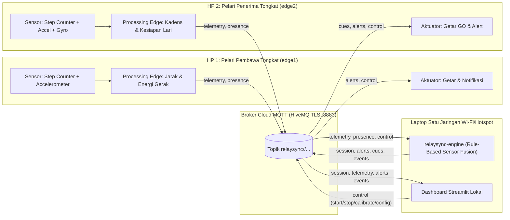
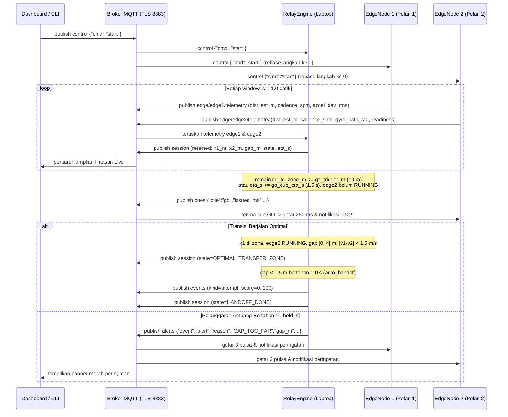
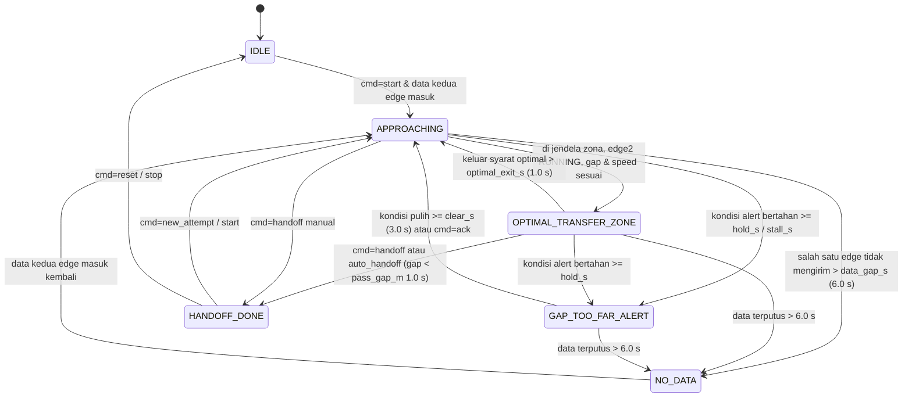

# Arsitektur Sistem dan Skema Komunikasi (ARCHITECTURE)

RelaySync menerapkan pola arsitektur **Ports and Adapters (Hexagonal Architecture)** yang memisahkan logika domain murni (`src/relaysync/domain/`) dari infrastruktur luar (`adapters/`, `services/`, `dashboard/`).

> **Catatan Kejujuran:** Jarak yang dipertukarkan adalah estimasi dari hitungan langkah dikalikan panjang langkah (`dist_est_m`), bukan GPS dan bukan alat ukur presisi.

## 1. Diagram Arsitektur Komponen (Mermaid)



## 2. Sequence Diagram Komunikasi Dua Arah (Cue GO dan Alert)



## 3. Diagram State Machine Engine



## 4. Tabel Topic MQTT (`relaysync/<TEAM_ID>/...`)

| Topic Relatif terhadap `relaysync/<TEAM_ID>/` | Pengirim -> Penerima | QoS | Retained | Keterangan |
|---|---|---|---|---|
| `edge/edge1/telemetry` | `edge1` -> `engine`, `dashboard` | 1 | Tidak | Fitur per jendela 1 detik dari pelari 1 |
| `edge/edge2/telemetry` | `edge2` -> `engine`, `dashboard` | 1 | Tidak | Fitur per jendela 1 detik dari pelari 2 (termasuk `gyro_path_rad` dan `readiness`) |
| `edge/edge1/presence` | `edge1` -> semua | 1 | Ya | `online` saat terhubung, Last Will `offline` saat putus |
| `edge/edge2/presence` | `edge2` -> semua | 1 | Ya | `online` saat terhubung, Last Will `offline` saat putus |
| `session` | `engine` -> semua | 1 | Ya | Ringkasan posisi, gap, kecepatan, status, ETA, skor |
| `alerts` | `engine` -> `edge1`, `edge2`, `dashboard` | 1 | Tidak | Sinyal `alert` atau `cleared` beserta alasan dan `gap_m` |
| `cues` | `engine` -> `edge2` | 1 | Tidak | Aba-aba `{"cue":"go","issued_ms":...}` untuk pelari 2 |
| `events` | `engine` -> `dashboard` | 1 | Tidak | Log transisi state, cue, alert, handoff, dan skor percobaan |
| `control` | `dashboard` / CLI -> `engine`, `edge1`, `edge2` | 1 | Tidak | Perintah tervalidasi whitelist (`start`, `stop`, `reset`, `ack`, `handoff`, `calibrate_step`, `config`, `new_attempt`) |

## 5. Spesifikasi Skema Payload JSON

### A. Telemetry (`edge/<role>/telemetry`)
Contoh payload `edge1`:
```json
{
  "v": 1,
  "dev": "edge1",
  "run": "6af9e0c9",
  "n_msg": 42,
  "t_ms": 1790000000000,
  "window_s": 1.0,
  "steps_total": 320,
  "dist_est_m": 240.0,
  "step_len_m": 0.75,
  "cadence_spm": 172.0,
  "accel_dev_rms": 2.1,
  "steps_src": "hw",
  "calibrated": true
}
```
Pada `edge2`, wajib terdapat dua field tambahan:
- `"gyro_path_rad": 0.45` (angka >= 0)
- `"readiness": "STATIONARY" | "ARMING" | "RUNNING"`

Aturan validasi di `messaging/codec.py`:
- `v` wajib bernilai `1`.
- Kunci objek JSON harus cocok persis (tidak boleh kurang atau ada field asing).
- `dev` wajib cocok dengan peran pada topic (`edge1` atau `edge2`).
- Semua angka wajib bertipe numerik (bukan boolean), finite (`math.isfinite`), dan berada di dalam rentang batas atas/bawah.
- `t_ms` yang menyimpang lebih dari `engine.max_clock_skew_s` (60 detik) dari jam laptop ditolak.
- `n_msg` harus naik monoton untuk pasangan `(dev, run)` yang sama (`SequenceGuard`).

### B. Session (`session`, retained)
```json
{
  "v": 1,
  "state": "OPTIMAL_TRANSFER_ZONE",
  "reason": "Posisi, jarak antar pelari, dan kecepatan sesuai.",
  "active": true,
  "x1_m": 58.5,
  "x2_m": 61.5,
  "gap_m": 3.0,
  "remaining_to_zone_m": 1.5,
  "v1_mps": 4.2,
  "v2_mps": 4.0,
  "cadence1_spm": 172.0,
  "cadence2_spm": 168.0,
  "readiness2": "RUNNING",
  "eta_s": 0.36,
  "alert_active": false,
  "alert_reason": null,
  "attempt_no": 1,
  "quality_score": null,
  "nodes_online": {"edge1": true, "edge2": true},
  "leg_length_m": 60.0,
  "zone_length_m": 20.0,
  "at_ms": 1790000015000
}
```

### C. Alert (`alerts`) dan Cue (`cues`)
- Alert: `{"event": "alert" | "cleared", "reason": "GAP_TOO_FAR" | "EARLY_START" | "RUNNER1_STALLED" | "ZONE_EXCEEDED", "gap_m": 9.25, "issued_ms": 1790000018000}`
- Cue: `{"cue": "go", "issued_ms": 1790000012000}`

### D. Control (`control`, Whitelist Ketat)
Hanya nilai `cmd` berikut yang diterima:
- `{"cmd": "start"}`
- `{"cmd": "stop"}`
- `{"cmd": "reset"}`
- `{"cmd": "ack"}`
- `{"cmd": "handoff"}`
- `{"cmd": "new_attempt"}`
- `{"cmd": "calibrate_step", "target": "edge1" | "edge2", "distance_m": 20.0}`
- `{"cmd": "config", "leg_length_m": 60.0, "zone_length_m": 20.0}`
